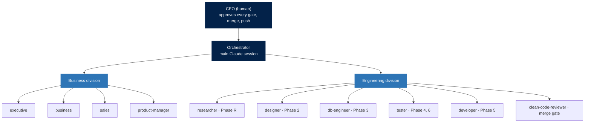

<p align="center">
  
</p>

<p align="center">
  
  
  
</p>

Claude Code skills and agents for GS Battery. Every role is a subagent in `agents/`, every
engineering rule comes from the `sop` skill, and the human CEO approves every gate, merge
and push. The full org chart and rules are in [`COMPANY.md`](COMPANY.md).

## Org chart



## Company rules

| # | Rule |
|---|---|
| 1 | **The CEO decides.** Agents propose; only the human approves a gate, merge, push or send. |
| 2 | **Every project starts on the AI track.** uv monorepo, Clean Architecture, house Python standard. |
| 3 | **TDD every time, at three levels.** Unit and integration in Vitest (`vitest --ui`) or `pytest`, E2E in Playwright, load in k6. |
| 4 | **Clean Code + Small PRs.** Every PR is one self-contained change and passes `clean-code-review`. |
| 5 | **Frontend is shadcn/ui only.** Never hand-write a component; variants with CVA. |
| 6 | **Every deck is McKinsey style.** Storyline and ghost deck first, then one fixed design system. |

## Engineering stack

<p align="center">
  
</p>

<p align="center">
  
  
  
  
</p>

## Skills

### Own

| Skill | What it does |
|---|---|
| [`sop`](skills/sop/) | GS Battery end-to-end SDLC SOP (from [Siam-GS-Battery/agent-skill](https://github.com/Siam-GS-Battery/agent-skill)): AI track, TDD, shadcn/ui + CVA |
| [`clean-code-writer`](skills/clean-code-writer/) | Rules an agent follows when it writes or refactors code |
| [`clean-code-reviewer`](skills/clean-code-reviewer/) | Read-only review that reports smells by code (C/E/F/G/N/T) with severity and fix |
| [`clean-code-review`](skills/clean-code-review/) | `/clean-code-review` command; runs the review in the `clean-code-reviewer` agent |
| [`small-prs`](skills/small-prs/) | Split work into small, self-contained PRs (Google "Small CLs", CC-BY 3.0) |
| [`mckinsey-slides`](skills/mckinsey-slides/) | McKinsey/BCG decks: SCQ, Pyramid, action titles, ghost deck, one design system |

### Business division

From [awesome-claude-corporate-skills](https://github.com/w95/awesome-claude-corporate-skills) (MIT).

<details>
<summary><b>executive</b>: 12 skills from <code>01-executive-leadership</code></summary>

`board-meeting-prep` · `change-management` · `competitive-analysis` · `deep-research` ·
`executive-communication` · `internal-comms` · `knowledge-synthesis` · `kpi-dashboard` ·
`ma-due-diligence` · `risk-assessment` · `strategic-planning` · `task-management`
</details>

<details>
<summary><b>business</b>: 13 skills from <code>07-operations</code>, <code>04-marketing</code>, <code>02-finance-accounting</code></summary>

`business-case-builder` · `file-organizer` · `incident-postmortem` · `kaizen` ·
`meeting-insights-analyzer` · `memory-management` · `process-optimization` ·
`project-status-report` · `resource-planning` · `sop-builder` · `vendor-management` ·
`market-research` · `unit-economics`
</details>

<details>
<summary><b>sales</b>: 16 skills from <code>05-sales</code></summary>

`account-research` · `account-research-common-room` · `call-prep` · `call-prep-common-room` ·
`competitive-intelligence` · `compose-outreach` · `contact-research` · `create-an-asset` ·
`daily-briefing` · `draft-outreach` · `enrich-lead` · `lead-research-assistant` ·
`prospect-apollo` · `prospect-common-room` · `sequence-load` · `weekly-prep-brief`
</details>

<details>
<summary><b>product-manager</b>: 10 skills from <code>09-product-management</code></summary>

`brainstorming` · `doc-coauthoring` · `feature-spec` · `prd-writer` ·
`product-launch-playbook` · `roadmap-builder` · `search-strategy` · `source-management` ·
`sprint-planning` · `user-research-synthesizer`
</details>

### Third-party

<details>
<summary><b>ponytail</b>: 6 skills, ponytail plugin v4.9.0 (MIT)</summary>

`ponytail` · `ponytail-audit` · `ponytail-debt` · `ponytail-gain` · `ponytail-help` ·
`ponytail-review`
</details>

<details>
<summary><b>mattpocock/skills</b>: 9 skills (MIT)</summary>

`batch-grill-me` · `design-an-interface` · `edit-article` · `obsidian-vault` · `qa` ·
`request-refactor-plan` · `resolving-merge-conflicts` · `ubiquitous-language` ·
`writing-great-skills`
</details>

## Install

Copy into a project (or `~/.claude/` for every project):

```bash
git clone https://github.com/SnipeBoss/SKILLS_Burased.git
cp -r SKILLS_Burased/skills/* .claude/skills/
cp SKILLS_Burased/agents/* .claude/agents/
```

The Thai setup guide for the SOP skill is in [`docs/setup-guide/`](docs/setup-guide/).

## Licences

| Source | Licence |
|---|---|
| [mattpocock/skills](https://github.com/mattpocock/skills) | [MIT](licenses/mattpocock-skills.LICENSE) |
| ponytail plugin (DietrichGebert) | [MIT](licenses/ponytail.LICENSE) |
| [awesome-claude-corporate-skills](https://github.com/w95/awesome-claude-corporate-skills) | [MIT](licenses/awesome-claude-corporate-skills.LICENSE) |
| [Google eng-practices](https://github.com/google/eng-practices) (summarised in `small-prs`) | CC-BY 3.0 |


